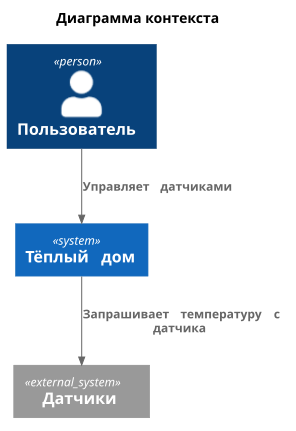
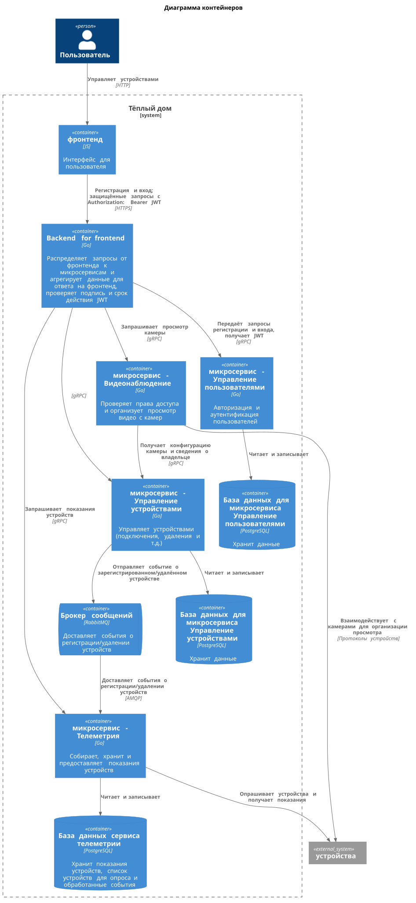
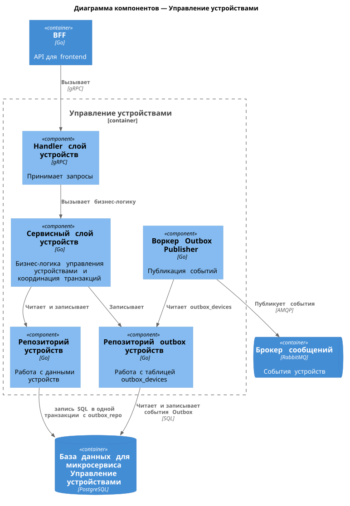
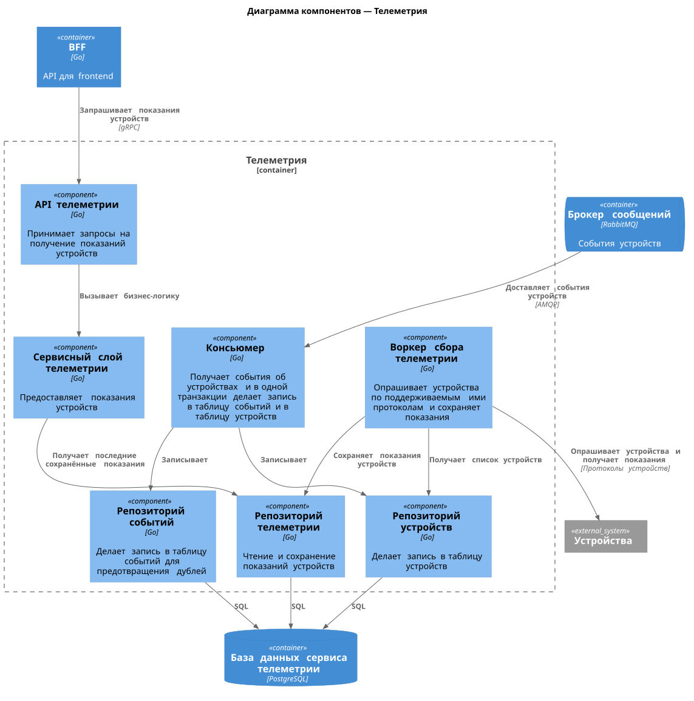
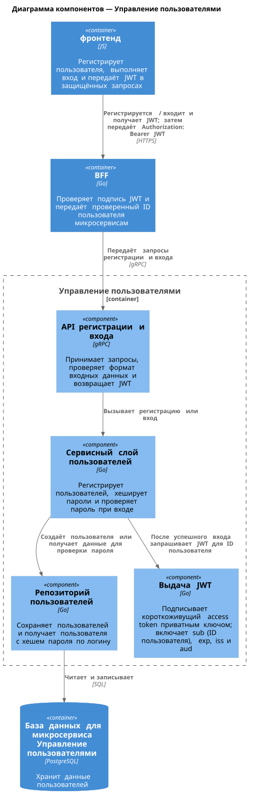
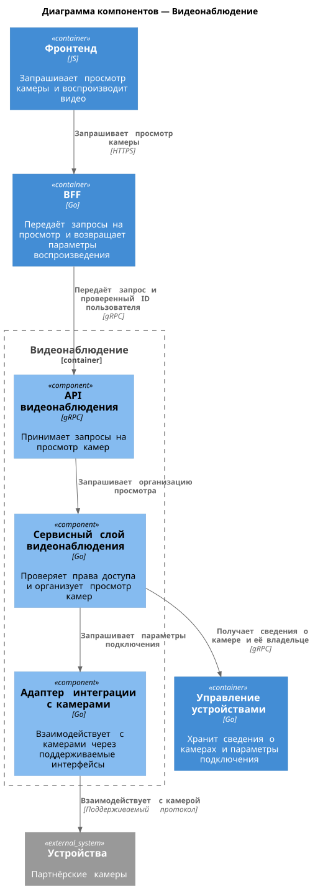
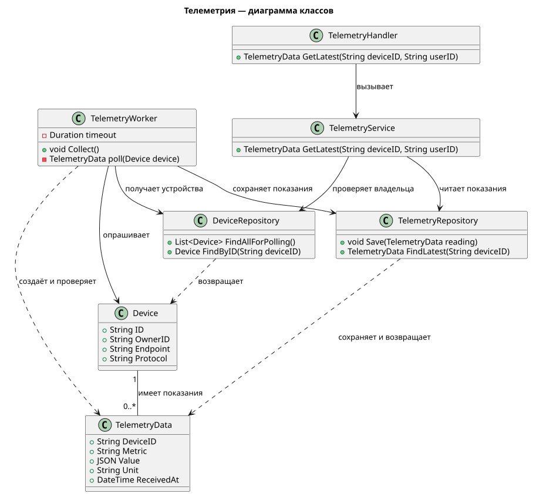
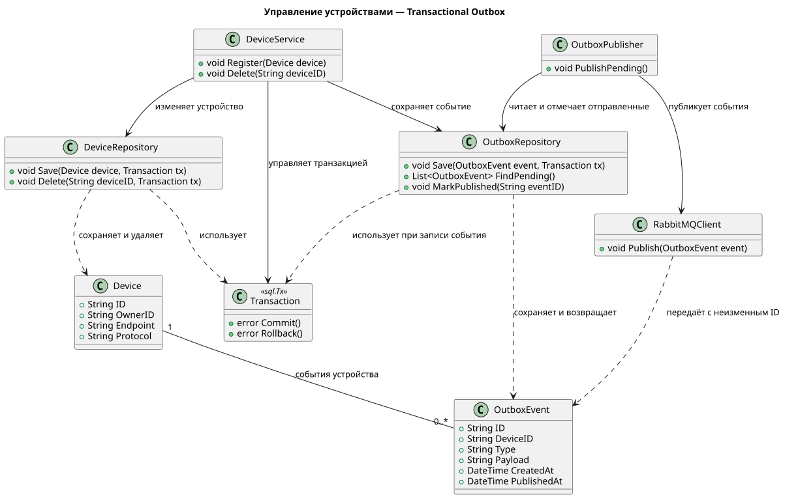
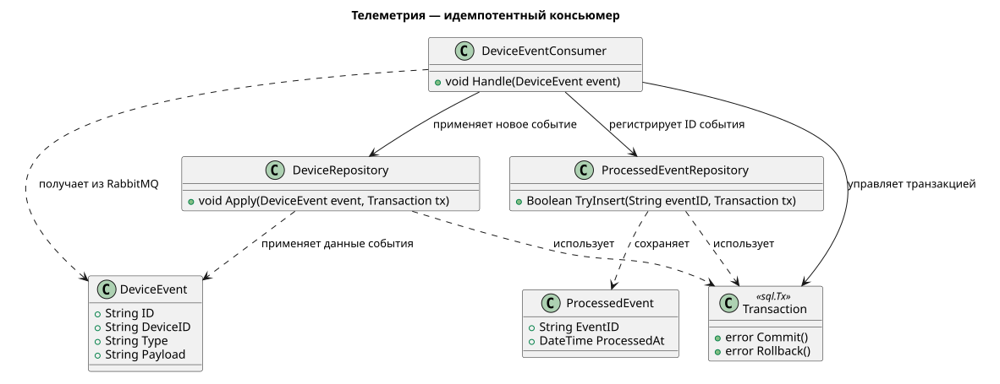
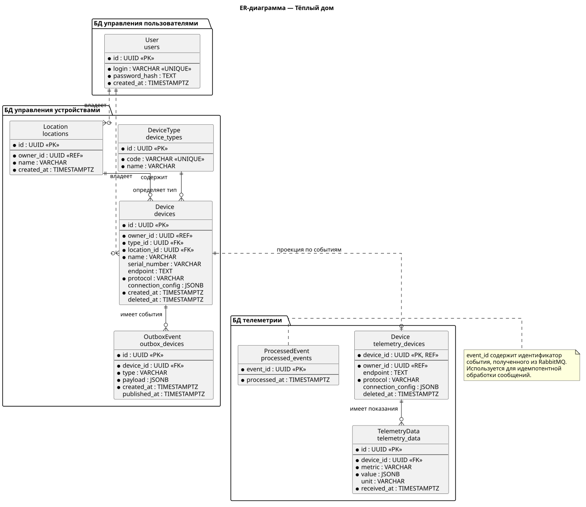

# Project_template

Это шаблон для решения проектной работы. Структура этого файла повторяет структуру заданий. Заполняйте его по мере работы над решением.

# Задание 1. Анализ и планирование

<aside>

Чтобы составить документ с описанием текущей архитектуры приложения, можно часть информации взять из описания компании и условия задания. Это нормально.

</aside

### 1. Описание функциональности монолитного приложения

**Управление отоплением:**

- Пользователи могут добавлять, удалять, изменять датчики и переключать их в разные статусы.
- Система поддерживает регистрацию (добавление) своих датчиков, а также удаление, изменение (а также переключение датчиков в разные статусы) и получение списка (или конкретно одного) своих зарегестрированных датчиков в системе.
- …

**Мониторинг температуры:**

- Пользователи могут получить температуру датчиков в определённой локации (комнате).
- Система поддерживает получение температуры с зарегистрированных датчиков. Также обновлять температуру датчиков во время получения списка датчиков.
- …

### 2. Анализ архитектуры монолитного приложения

- Язык программирования: Go (с использованием фреймворка gin)
- База данных: PostgreSQL
- Архитектура: Монолитная, все компоненты системы (обработка запросов, бизнес-логика, работа с данными) находятся в рамках одного приложения.
- Взаимодействие: Синхронное, запросы обрабатываются последовательно.
- Внешние сервисы: приложение ходит в свою бд, а также ходит по http к сервису(который опрашивает датчики)/к датчику за температурой.

### 3. Определение доменов и границы контекстов

**Домен: Управление отоплением**

- поддомен управление сенсорами

**Домен: Мониторинг температуры**

- поддомен отслеживание температуры

### **4. Проблемы монолитного решения**

В текущем виде монолитное решение вполне эффективно, так как сервис очень маленький, он легко читается, легко поддерживается, легко развёртывается (не нужна поддержка инфраструктуры и devOps-команда), но есть сейчас проблема, где смешались два домена, а именно в момент управления отоплением (получение датчиков) происходит работа с мониторингом температуры, это в свою очередь может дать проблемы с долгим ответом пользователю, если, например, когда он пытается получить список своих датчиков, а в этот момент синхронно будут идти запросы ко всем его датчикам, а сеть слабая, где-нибудь в отдалённой местносте интернет плохо ловит, то пользователь будет очень долго ждать список, который и вовсе может быть отключён по тайм-ауту. В данном случае можно в рамках монолитной архитектуры эту проблему исправить, например, сделать бэкграунд джобу, которая будет акутализировать температуру датчиков или хотя бы сделать concurency запросы и обновить температуры, прежде, чем отдать список датчиков.

Но в теории, на будущее расширение тут такие проблемы монолитного решения:

- Масштабировать отдельный домен не получится, придётся добавлять ресурсы для всего монолита, чтобы удовлетворить нагрузку, например, только на один мониторинг температуры.

### 5. Визуализация контекста системы — диаграмма С4



[Исходный файл диаграммы](schemas/context.puml)

# Задание 2. Проектирование микросервисной архитектуры

В этом задании вам нужно предоставить только диаграммы в модели C4. Мы не просим вас отдельно описывать получившиеся микросервисы и то, как вы определили взаимодействия между компонентами To-Be системы. Если вы правильно подготовите диаграммы C4, они и так это покажут.

**Диаграмма контейнеров (Containers)**



[Исходный файл диаграммы](schemas/2/container.puml)

**Диаграмма компонентов (Components)**



[Исходный файл диаграммы](schemas/2/components-devices.puml)



[Исходный файл диаграммы](schemas/2/components-telemetry.puml)



[Исходный файл диаграммы](schemas/2/components-users.puml)



[Исходный файл диаграммы](schemas/2/components-video.puml)

**Диаграмма кода (Code)**



[Исходный файл диаграммы](schemas/2/code-telemetry-classes.puml)



[Исходный файл диаграммы](schemas/2/code-devices-outbox.puml)



[Исходный файл диаграммы](schemas/2/code-telemetry-consumer.puml)

# Задание 3. Разработка ER-диаграммы

[Исходный файл ER-диаграммы](schemas/3/er.puml)


# Задание 4. Создание и документирование API

### 1. Тип API

Укажите, какой тип API вы будете использовать для взаимодействия микросервисов. Объясните своё решение.

### 2. Документация API

Здесь приложите ссылки на документацию API для микросервисов, которые вы спроектировали в первой части проектной работы. Для документирования используйте Swagger/OpenAPI или AsyncAPI.

# Задание 5. Работа с docker и docker-compose

Перейдите в apps.

Там находится приложение-монолит для работы с датчиками температуры. В README.md описано как запустить решение.

Вам нужно:

1) сделать простое приложение temperature-api на любом удобном для вас языке программирования, которое при запросе /temperature?location= будет отдавать рандомное значение температуры.

Locations - название комнаты, sensorId - идентификатор названия комнаты

```
	// If no location is provided, use a default based on sensor ID
	if location == "" {
		switch sensorID {
		case "1":
			location = "Living Room"
		case "2":
			location = "Bedroom"
		case "3":
			location = "Kitchen"
		default:
			location = "Unknown"
		}
	}

	// If no sensor ID is provided, generate one based on location
	if sensorID == "" {
		switch location {
		case "Living Room":
			sensorID = "1"
		case "Bedroom":
			sensorID = "2"
		case "Kitchen":
			sensorID = "3"
		default:
			sensorID = "0"
		}
	}
```

2) Приложение следует упаковать в Docker и добавить в docker-compose. Порт по умолчанию должен быть 8081

3) Кроме того для smart_home приложения требуется база данных - добавьте в docker-compose файл настройки для запуска postgres с указанием скрипта инициализации ./smart_home/init.sql

Для проверки можно использовать Postman коллекцию smarthome-api.postman_collection.json и вызвать:

- Create Sensor
- Get All Sensors

Должно при каждом вызове отображаться разное значение температуры

Ревьюер будет проверять точно так же.


# **Задание 6. Разработка MVP**

Необходимо создать новые микросервисы и обеспечить их интеграции с существующим монолитом для плавного перехода к микросервисной архитектуре. 

### **Что нужно сделать**

1. Создайте новые микросервисы для управления телеметрией и устройствами (с простейшей логикой), которые будут интегрированы с существующим монолитным приложением. Каждый микросервис на своем ООП языке.
2. Обеспечьте взаимодействие между микросервисами и монолитом (при желании с помощью брокера сообщений), чтобы постепенно перенести функциональность из монолита в микросервисы. 

В результате у вас должны быть созданы Dockerfiles и docker-compose для запуска микросервисов. 